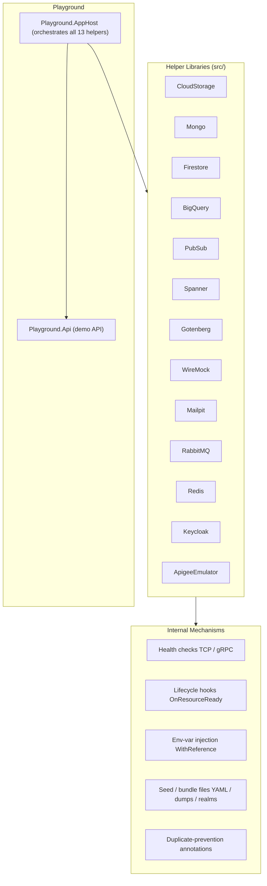

# MVFC.Aspire.Helpers

> 🇧🇷 [Leia em Português](README.pt-BR.md)

[](https://github.com/Marcus-V-Freitas/MVFC.Aspire.Helpers/actions/workflows/ci.yml)
[](https://codecov.io/gh/Marcus-V-Freitas/MVFC.Aspire.Helpers)
[](LICENSE)


A collection of helpers to integrate common services with .NET Aspire quickly and in a standardized way.

> 🏢 **Enterprise Validation: Featured on GFT Technologies**
> 
> **[Read the full article on the GFT Engineering Blog](https://www.gft.com/br/pt/blog/net-aspire-na-pratica-simplificando-a-orquestracao)**
> 
> *`MVFC.Aspire.Helpers` was built to solve real local orchestration challenges at an enterprise scale. Featured by a global powerhouse in technology, this article details how the library simplifies configuring services like MongoDB, RabbitMQ, and Keycloak. Discover how these abstractions reduce developer cognitive load and enable Shift-Left Testing in complex environments.*

## Motivation

Orchestrating a realistic local environment for .NET distributed applications usually means:

- Writing and maintaining multiple `docker-compose` files.
- Copy‑pasting container definitions between projects.
- Manually wiring ports, connection strings and health checks.
- Repeating the same setup for every new service in every new solution.

.NET Aspire solves part of this problem by giving you a first‑class orchestration model in C#, but you still have to model each infrastructure dependency (Mongo, Redis, Keycloak, etc.) yourself.

**MVFC.Aspire.Helpers** packages capture this knowledge once and expose it as small, focused helpers:

- One line to add the resource (`AddXxx`).
- A few fluent methods to customize it (`WithDataVolume`, `WithDumps`, `WithSeeds`, `WithCommander`, etc.).
- A single `WithReference(...)` call to link your projects to the resource with the right environment variables and dependencies.

The goal is simple: make your local environment **as close as possible to production** while keeping the developer experience **clone → run**.

## Extension pattern

All libraries follow the same convention:

- `AddXxx(...)` — registers the infrastructure resource in the `IDistributedApplicationBuilder`.
- Fluent methods (`WithDataVolume`, `WithDumps`, `WithSeeds`, etc.) — customize the resource.
- `project.WithReference(xxx)` — links a project to the resource, automatically configuring:
  - Environment variables (connection strings, base URLs, etc.).
  - Initialization actions (e.g. executing Mongo dumps).

When a consumer must wait for a resource to become ready, add `.WaitFor(resource)` explicitly. `WithReference(...)` does not guarantee a startup dependency for every helper.

Once you learn how one helper works, the others feel immediately familiar.

## Overview

| Package                                                                                | Service                             | Downloads                                                                        |
| -------------------------------------------------------------------------------------- | ----------------------------------- | -------------------------------------------------------------------------------- |
| [MVFC.Aspire.Helpers.CloudStorage](src/MVFC.Aspire.Helpers.CloudStorage/README.md)     | Google Cloud Storage (GCS emulator) |    |
| [MVFC.Aspire.Helpers.Mongo](src/MVFC.Aspire.Helpers.Mongo/README.md)                   | MongoDB with Replica Set            |           |
| [MVFC.Aspire.Helpers.GcpFirestore](src/MVFC.Aspire.Helpers.GcpFirestore/README.md)     | Google Cloud Firestore (emulator)   |    |
| [MVFC.Aspire.Helpers.GcpBigQuery](src/MVFC.Aspire.Helpers.GcpBigQuery/README.md)       | Google Cloud BigQuery (emulator)    |     |
| [MVFC.Aspire.Helpers.GcpPubSub](src/MVFC.Aspire.Helpers.GcpPubSub/README.md)           | Google Pub/Sub (emulator + UI)      |       |
| [MVFC.Aspire.Helpers.GcpSpanner](src/MVFC.Aspire.Helpers.GcpSpanner/README.md)         | Google Cloud Spanner (emulator)     |      |
| [MVFC.Aspire.Helpers.Gotenberg](src/MVFC.Aspire.Helpers.Gotenberg/README.md)           | Gotenberg (PDF conversion)          |       |
| [MVFC.Aspire.Helpers.WireMock](src/MVFC.Aspire.Helpers.WireMock/README.md)             | WireMock.Net (API mocking)          |        |
| [MVFC.Aspire.Helpers.Mailpit](src/MVFC.Aspire.Helpers.Mailpit/README.md)               | Mailpit (SMTP emulator)             |         |
| [MVFC.Aspire.Helpers.RabbitMQ](src/MVFC.Aspire.Helpers.RabbitMQ/README.md)             | RabbitMQ                            |        |
| [MVFC.Aspire.Helpers.Redis](src/MVFC.Aspire.Helpers.Redis/README.md)                   | Redis + Redis Commander             |           |
| [MVFC.Aspire.Helpers.Keycloak](src/MVFC.Aspire.Helpers.Keycloak/README.md)             | Keycloak                            |        |
| [MVFC.Aspire.Helpers.ApigeeEmulator](src/MVFC.Aspire.Helpers.ApigeeEmulator/README.md) | Apigee Emulator (API proxy)         |  |

---

## Installation

```sh
dotnet add package MVFC.Aspire.Helpers.CloudStorage
dotnet add package MVFC.Aspire.Helpers.Mongo
dotnet add package MVFC.Aspire.Helpers.GcpFirestore
dotnet add package MVFC.Aspire.Helpers.GcpBigQuery
dotnet add package MVFC.Aspire.Helpers.GcpPubSub
dotnet add package MVFC.Aspire.Helpers.GcpSpanner
dotnet add package MVFC.Aspire.Helpers.Gotenberg
dotnet add package MVFC.Aspire.Helpers.WireMock
dotnet add package MVFC.Aspire.Helpers.Mailpit
dotnet add package MVFC.Aspire.Helpers.RabbitMQ
dotnet add package MVFC.Aspire.Helpers.Redis
dotnet add package MVFC.Aspire.Helpers.Keycloak
dotnet add package MVFC.Aspire.Helpers.ApigeeEmulator
```

---

## Usage Example

```csharp
var builder = DistributedApplication.CreateBuilder(args);
var api = builder.AddProject<Projects.MyApi>("api");

var cloudStorage = builder.AddCloudStorage("cloud-storage")
    .WithBucketFolder("./bucket-data");

var mongo = builder.AddMongoReplicaSet("mongo")
    .WithDumps(dumps);

var firestore = builder.AddGcpFirestore("gcp-firestore")
    .WithFirestoreConfigs(firestoreConfig);

var bigQuery = builder.AddGcpBigQuery("gcp-bigquery")
    .WithBigQueryConfigs(new BigQueryConfig("test-project", "test_dataset"))
    .WithDataSeed("./bigquery-data/dump.yaml");

var pubSubConfig = new PubSubConfig("test-project", new MessageConfig("events", "api-events", "/events")
{
    PushEndpointReference = api.GetEndpoint("http"),
});

var pubSub = builder.AddGcpPubSub("gcp-pubsub")
    .WithPubSubConfigs(pubSubConfig);

api.WithReference(pubSub)
    .WaitFor(pubSub);

var spanner = builder.AddGcpSpanner("spanner")
    .WithSpannerConfigs(spannerConfig);

var mailpit = builder.AddMailpit("mailpit");

var rabbitMQ = builder.AddRabbitMQ("rabbitmq")
    .WithExchanges([new ExchangeConfig("test-exchange", "topic")])
    .WithQueues([new QueueConfig(Name: "test-queue", ExchangeName: "test-exchange", RoutingKey: "test.*")])
    .WithDataVolume("rabbit-mq");

var redis = builder.AddRedis("redis")
    .WithCommander()
    .WithDataVolume("redis-data");

var gotenberg = builder.AddGotenberg("gotenberg", port: 3000);

var keycloak = builder.AddKeycloak("keycloak")
    .WithAdminCredentials("admin", "Admin@123")
    .WithSeeds([new MyAppRealm()])
    .WithDataVolume("key-cloak-data");

var wireMock = builder.AddWireMock("wireMock", port: 7070, configure: (server) => {
    server.Endpoint("/api/test")
          .WithDefaultBodyType(BodyType.String)
          .OnGet<string>(() => ("OK", HttpStatusCode.OK, null));
});

var apigeeWorkspace = Path.Combine(Directory.GetCurrentDirectory(), "apigee-workspace");

var apigee = builder.AddApigeeEmulator("apigee-emulator")
    .WithWorkspace(apigeeWorkspace, "health")
    .WithEnvironment("local")
    .WithBackend(api, "origin");

await builder.Build().RunAsync().ConfigureAwait(false);
```

You can configure MongoDB dumps with `WithDumps` before or after `WithReference`. The dumps run once when the project from the first `WithReference` call becomes ready. See the [MongoDB helper documentation](src/MVFC.Aspire.Helpers.Mongo/README.md#quick-aspire-usage-apphost).

### Pub/Sub: migration to version 12

Push subscriptions now require both the HTTP route in `MessageConfig.PushEndpoint` and the consumer endpoint in `MessageConfig.PushEndpointReference`, as shown above. Create the consumer project before its message configuration. `WithReference(pubSub)` configures the connection and project IDs; it no longer selects the push destination. A push route without an endpoint reference raises `InvalidOperationException` at initialization.

Each subscription can target a different consumer, independently of reference order. To deliver a topic's messages to multiple consumers, configure a separate subscription and endpoint reference for each. Pull subscriptions do not require an endpoint reference.

The allocated consumer port is resolved per subscription within the shared 60-second initialization deadline, including emulator endpoint resolution, client creation and SDK retries. AppHost cancellation interrupts initialization; expiration of the deadline raises `TimeoutException`. `WithWaitTimeout` controls the emulator image's own initialization timeout.

See the [Pub/Sub configuration and multiple-consumer example](src/MVFC.Aspire.Helpers.GcpPubSub/README.md#push-delivery-to-multiple-consumers) and the [version 12 breaking changes](CHANGELOG.md#1200---2026-11-24).

> See [playground/](playground/) for the full working example.

---

## Project Structure

```
src/
  MVFC.Aspire.Helpers.CloudStorage/
  MVFC.Aspire.Helpers.GcpFirestore/
  MVFC.Aspire.Helpers.GcpBigQuery/
  MVFC.Aspire.Helpers.GcpPubSub/
  MVFC.Aspire.Helpers.GcpSpanner/
  MVFC.Aspire.Helpers.Gotenberg/
  MVFC.Aspire.Helpers.Keycloak/
  MVFC.Aspire.Helpers.Mailpit/
  MVFC.Aspire.Helpers.Mongo/
  MVFC.Aspire.Helpers.RabbitMQ/
  MVFC.Aspire.Helpers.Redis/
  MVFC.Aspire.Helpers.WireMock/
  MVFC.Aspire.Helpers.ApigeeEmulator/
tests/
  MVFC.Aspire.Helpers.Tests/
    Unit/          <- per-helper unit tests (xUnit v3, Microsoft.Testing.Platform)
    Integration/   <- integration tests wired to the AppHost (Aspire.Hosting.Testing)
playground/
  MVFC.Aspire.Helpers.Playground.AppHost/   <- orchestrates all 13 helpers
  MVFC.Aspire.Helpers.Playground.Api/       <- demo API consumed by the AppHost
```

---

## Architecture Overview



### Internal mechanics (architectural note)

Several helpers go beyond a simple `AddContainer` call:

| Mechanism                                                                                                   | Helpers that use it                  |
| ----------------------------------------------------------------------------------------------------------- | ------------------------------------ |
| **`OnResourceReady` lifecycle hook** — provisions topics, schemas or indexes after the container is healthy | PubSub, Firestore, Spanner, BigQuery |
| **Custom TCP / gRPC health checks**                                                                         | Firestore, Spanner                   |
| **Seed / bundle file generation** — writes temporary YAML or archive files at startup                       | BigQuery, Mongo, Keycloak            |
| **Automatic env-var injection** — `WithReference(xxx)` sets connection strings and project IDs              | All helpers                          |
| **Duplicate-prevention annotations** — prevent registering the same resource twice                          | Mongo, PubSub, Spanner, Keycloak     |

---

## Dependencies

All package versions are managed centrally in [`Directory.Packages.props`](Directory.Packages.props) (`ManagePackageVersionsCentrally = true`). Key runtime dependencies:

| Dependency                                      | Version  |
| ----------------------------------------------- | -------- |
| `Aspire.Hosting`                                | `13.6.5` |
| `Google.Cloud.PubSub.V1`                        | `3.39.0` |
| `Google.Cloud.Storage.V1`                       | `5.0.0`  |
| `Google.Cloud.Firestore`                        | `4.6.0`  |
| `Google.Cloud.BigQuery.V2`                      | `3.12.0` |
| `Google.Cloud.Spanner.*`                        | `5.12.0` |
| `MongoDB.Driver`                                | `3.14.0` |
| `RabbitMQ.Client`                               | `7.2.2`  |
| `StackExchange.Redis`                           | `3.4.35` |
| `WireMock.Net.minimal`                          | `2.31.0` |
| `Bogus` (seed data)                             | `35.6.5` |
| `Microsoft.Extensions.Diagnostics.HealthChecks` | per TFM  |
| `MinVer` (SemVer via git tags)                  | `8.0.0`  |

---

## Testing

```
tests/MVFC.Aspire.Helpers.Tests/
  Unit/        <- isolated tests per helper, no containers required
  Integration/ <- full AppHost spin-up via Aspire.Hosting.Testing
```

- **Framework:** xUnit v3 + `Microsoft.Testing.Platform`
- **Coverage:** `dotnet cake` collects coverage with `dotnet-coverage` and generates the HTML report with ReportGenerator in `CoverageReport/index.html`.
- **Integration tests** boot the `Playground.AppHost` and exercise real containers.

---

## Publishing

Packages are published automatically on CI when a `v*` tag is pushed. Version numbers are derived from git tags by **MinVer** and each package targets `net9.0;net10.0;net11.0`.

---

## Requirements

- .NET 9, 10 or 11
- Aspire.Hosting >= 13.6.5
- Docker running locally

> **Development environment:** the SDK pin in `global.json` is `10.0.100` (with `latestMajor` roll-forward and pre-releases enabled). Library consumers only need a runtime that targets `net9.0`, `net10.0` or `net11.0`.

---

## Contributing

See [CONTRIBUTING.md](CONTRIBUTING.md).

## License

[Apache-2.0](LICENSE)

## Resilience and consumer configuration

- [MongoDB](src/MVFC.Aspire.Helpers.Mongo/README.md#repeatable-seeds): optional seeds by stable `_id`; append seeds remain available.
- [Redis](src/MVFC.Aspire.Helpers.Redis/README.md#consumer-authentication): project references provide host/port and the separate secret `Redis:<resource-name>:Password` setting, preserving passwords with commas.
- [RabbitMQ](src/MVFC.Aspire.Helpers.RabbitMQ/README.md#authenticated-connection-references): references provide the authenticated AMQP URI; no duplicate consumer credentials are required.
- [Spanner](src/MVFC.Aspire.Helpers.GcpSpanner/README.md#provisioning-deadline-and-recovery) and [WireMock](src/MVFC.Aspire.Helpers.WireMock/README.md#readiness): bounded provisioning and truthful readiness.

For optional local verification after the regular Cake build, run `pwsh -File eng/verify-compatibility.ps1` to validate package APIs against published 12.0.0 and consume locally packed artifacts on .NET 9, 10 and 11. On Windows PowerShell, use `powershell -NoProfile -ExecutionPolicy Bypass -File eng/verify-compatibility.ps1` if script execution is disabled; this applies only to that process. The harness has no reference to the playground AppHost and is intentionally outside the main solution.

## Playground HTTP scenarios

The [httpyac collection](playground/http/README.md) includes 12 scenarios and 40 requests covering connectivity, persistence, authentication, messaging, PDF generation and local email capture. With the Aspire playground running, set the dashboard URLs in [variables.http](playground/http/variables.http), then open a scenario in the httpyac VS Code extension or run it directly:

```sh
httpyac send playground/http/01-smoke.http --all --bail --output short
```

Shared variables are imported by every scenario; no environment files or PowerShell runner are required. RabbitMQ uses a temporary isolated queue. The Storage scenario deletes bucket objects and is disabled by default; see the collection guide before enabling it. Apigee is outside this collection's scope.
