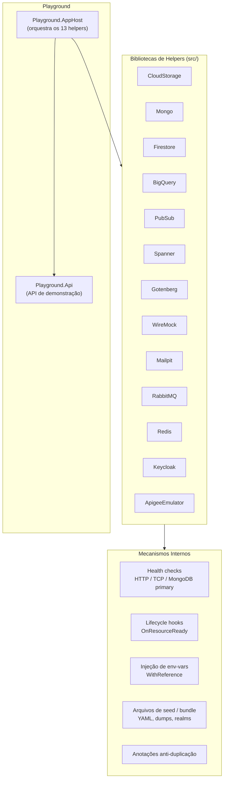

# MVFC.Aspire.Helpers

> 🇺🇸 [Read in English](README.md)

[](https://github.com/Marcus-V-Freitas/MVFC.Aspire.Helpers/actions/workflows/ci.yml)
[](https://codecov.io/gh/Marcus-V-Freitas/MVFC.Aspire.Helpers)
[](LICENSE)


Coleção de helpers para integrar serviços comuns com o .NET Aspire de forma rápida e padronizada.

> 🏢 **Validação Corporativa: Destaque na GFT Technologies**
> 
> **[Leia o artigo completo no blog de engenharia da GFT](https://www.gft.com/br/pt/blog/net-aspire-na-pratica-simplificando-a-orquestracao)**
> 
> *O `MVFC.Aspire.Helpers` foi construído para resolver desafios reais de orquestração em escala corporativa. Publicado no blog de uma gigante global de tecnologia, este artigo detalha como a biblioteca simplifica a configuração de serviços como MongoDB, RabbitMQ e Keycloak. Descubra como essas abstrações reduzem a carga cognitiva dos times e habilitam o Shift-Left Testing em ambientes complexos.*

---

## Motivação

Orquestrar um ambiente local realista para aplicações distribuídas em .NET normalmente significa:

- Escrever e manter vários arquivos `docker-compose`.
- Copiar e colar definições de containers entre projetos.
- Ligar portas, connection strings e health checks na mão.
- Repetir o mesmo setup para cada serviço novo em cada solução nova.

O .NET Aspire resolve parte desse problema ao oferecer um modelo de orquestração em C#, mas você ainda precisa modelar cada dependência de infraestrutura (Mongo, Redis, Keycloak, etc.) sozinho.

Os pacotes do **MVFC.Aspire.Helpers** capturam esse conhecimento uma vez e expõem como pequenos helpers focados:

- Uma linha para adicionar o recurso (`AddXxx`).
- Alguns métodos fluentes para customizar (`WithDataVolume`, `WithDumps`, `WithSeeds`, `WithCommander`, etc.).
- Um único `WithReference(...)` para ligar seus projetos ao recurso com as variáveis de ambiente e dependências corretas.

O objetivo é simples: tornar o ambiente local **o mais próximo possível de produção**, mantendo a experiência de desenvolvimento **clone → run**.

## Padrão das extensões

Todas as bibliotecas seguem a mesma convenção:

- `AddXxx(...)` — registra o recurso de infraestrutura no `IDistributedApplicationBuilder`.
- Métodos fluentes (`WithDataVolume`, `WithDumps`, `WithSeeds`, etc.) — customizam o recurso.
- `project.WithReference(xxx)` — liga um projeto ao recurso, configurando automaticamente:
  - Variáveis de ambiente (connection strings, base URLs, etc.).
  - Ações de inicialização (ex: executar dumps do Mongo).

Quando um consumidor precisar aguardar um recurso ficar pronto, adicione `.WaitFor(resource)` explicitamente. `WithReference(...)` não garante uma dependência de inicialização em todos os helpers.

Depois que você aprende como um helper funciona, os demais parecem imediatamente familiares.

## Visão Geral

| Pacote                                                                                   | Serviço                             | Downloads                                                                        |
| ---------------------------------------------------------------------------------------- | ----------------------------------- | -------------------------------------------------------------------------------- |
| [MVFC.Aspire.Helpers.CloudStorage](src/MVFC.Aspire.Helpers.CloudStorage/README.md)       | Google Cloud Storage (emulador GCS) |    |
| [MVFC.Aspire.Helpers.Mongo](src/MVFC.Aspire.Helpers.Mongo/README.md)                     | MongoDB com Replica Set             |           |
| [MVFC.Aspire.Helpers.GcpFirestore](src/MVFC.Aspire.Helpers.GcpFirestore/README.pt-BR.md) | Google Cloud Firestore (emulador)   |    |
| [MVFC.Aspire.Helpers.GcpBigQuery](src/MVFC.Aspire.Helpers.GcpBigQuery/README.pt-BR.md)   | Google Cloud BigQuery (emulador)    |     |
| [MVFC.Aspire.Helpers.GcpPubSub](src/MVFC.Aspire.Helpers.GcpPubSub/README.pt-BR.md)             | Google Pub/Sub (emulador + UI)      |       |
| [MVFC.Aspire.Helpers.GcpSpanner](src/MVFC.Aspire.Helpers.GcpSpanner/README.md)           | Google Cloud Spanner (emulador)     |      |
| [MVFC.Aspire.Helpers.Gotenberg](src/MVFC.Aspire.Helpers.Gotenberg/README.md)             | Gotenberg (conversão de PDF)        |       |
| [MVFC.Aspire.Helpers.WireMock](src/MVFC.Aspire.Helpers.WireMock/README.md)               | WireMock.Net (mock de APIs)         |        |
| [MVFC.Aspire.Helpers.Mailpit](src/MVFC.Aspire.Helpers.Mailpit/README.md)                 | Mailpit (emulador SMTP)             |         |
| [MVFC.Aspire.Helpers.RabbitMQ](src/MVFC.Aspire.Helpers.RabbitMQ/README.md)               | RabbitMQ                            |        |
| [MVFC.Aspire.Helpers.Redis](src/MVFC.Aspire.Helpers.Redis/README.md)                     | Redis + Redis Commander             |           |
| [MVFC.Aspire.Helpers.Keycloak](src/MVFC.Aspire.Helpers.Keycloak/README.md)               | Keycloak                            |        |
| [MVFC.Aspire.Helpers.ApigeeEmulator](src/MVFC.Aspire.Helpers.ApigeeEmulator/README.md)   | Apigee Emulator (API proxy)         |  |

---

## Instalação

```sh
dotnet add package MVFC.Aspire.Helpers.CloudStorage
dotnet add package MVFC.Aspire.Helpers.Mongo
dotnet add package MVFC.Aspire.Helpers.GcpFirestore
dotnet add package MVFC.Aspire.Helpers.GcpBigQuery
dotnet add package MVFC.Aspire.Helpers.GcpPubSub
dotnet add package MVFC.Aspire.Helpers.GcpSpanner
dotnet add package MVFC.Aspire.Helpers.Gotenberg
dotnet add package MVFC.Aspire.Helpers.WireMock
dotnet add package MVFC.Aspire.Helpers.Mailpit
dotnet add package MVFC.Aspire.Helpers.RabbitMQ
dotnet add package MVFC.Aspire.Helpers.Redis
dotnet add package MVFC.Aspire.Helpers.Keycloak
dotnet add package MVFC.Aspire.Helpers.ApigeeEmulator
dotnet add package Aspire.Hosting.Dotnet --version 17.0.0
```

---

## Exemplo de Uso

```csharp
var builder = DistributedApplication.CreateBuilder(args);
var api = builder.AddDotnetProject("api", "../MyApi/MyApi.csproj");

var cloudStorage = builder.AddCloudStorage("cloud-storage")
    .WithBucketFolder("./bucket-data");

var mongo = builder.AddMongoReplicaSet("mongo")
    .WithPrimaryHealthCheck()
    .WithDumps(dumps);

var firestore = builder.AddGcpFirestore("gcp-firestore")
    .WithFirestoreConfigs(firestoreConfig);

var bigQuery = builder.AddGcpBigQuery("gcp-bigquery")
    .WithBigQueryConfigs(new BigQueryConfig("test-project", "test_dataset"))
    .WithDataSeed("./bigquery-data/dump.yaml");

var pubSubConfig = new PubSubConfig("test-project", new MessageConfig("events", "api-events", "/events")
{
    PushEndpointReference = api.GetEndpoint("http"),
});

var pubSub = builder.AddGcpPubSub("gcp-pubsub")
    .WithPubSubConfigs(pubSubConfig);

api.WithReference(pubSub)
    .WaitFor(pubSub);

var spanner = builder.AddGcpSpanner("spanner")
    .WithSpannerConfigs(spannerConfig);

var mailpit = builder.AddMailpit("mailpit");

var rabbitMQ = builder.AddRabbitMQ("rabbitmq")
    .WithExchanges([new ExchangeConfig("test-exchange", "topic")])
    .WithQueues([new QueueConfig(Name: "test-queue", ExchangeName: "test-exchange", RoutingKey: "test.*")])
    .WithDataVolume("rabbit-mq");

var redis = builder.AddRedis("redis")
    .WithTcpHealthCheck()
    .WithCommander()
    .WithDataVolume("redis-data");

var gotenberg = builder.AddGotenberg("gotenberg", port: 3000);

var keycloak = builder.AddKeycloak("keycloak")
    .WithAdminCredentials("admin", "Admin@123")
    .WithSeeds([new MyAppRealm()])
    .WithDataVolume("key-cloak-data");

var wireMock = builder.AddWireMock("wireMock", port: 7070, configure: (server) => {
    server.Endpoint("/api/test")
          .WithDefaultBodyType(BodyType.String)
          .OnGet<string>(() => ("OK", HttpStatusCode.OK, null));
});

var apigeeWorkspace = Path.Combine(Directory.GetCurrentDirectory(), "apigee-workspace");

var apigee = builder.AddApigeeEmulator("apigee-emulator")
    .WithWorkspace(apigeeWorkspace, "health")
    .WithEnvironment("local")
    .WithBackend(api, "origin");

await builder.Build().RunAsync().ConfigureAwait(false);
```

Você pode configurar os dumps do MongoDB com `WithDumps` antes ou depois de `WithReference`. Por padrão, os dumps são executados uma vez quando o projeto da primeira chamada a `WithReference` fica pronto. Se o startup precisar dos dados populados, use `api.WithReference(mongo).WaitForDumps(mongo)`: a opção aguarda um primary gravável e a conclusão compartilhada dos dumps antes de iniciar o consumidor. O playground usa essa opção. Consulte a [documentação do helper MongoDB](src/MVFC.Aspire.Helpers.Mongo/README.pt-BR.md#uso-rápido-no-aspire-apphost).

As imagens padrão de Cloud Storage, BigQuery, Firestore, Pub/Sub/UI, Spanner, Mailpit, MongoDB, Redis e Redis Commander são fixadas por digests SHA256 testados, preservando as sobrescritas existentes. Consulte os [contratos de execução e evolução da plataforma](docs/runtime-contracts.pt-BR.md) para as garantias de prontidão e limites dos emuladores. Os assets dos pacotes usam Aspire **13.6.5 no .NET 9** e **17.0.0 no .NET 10/11**. O playground usa `Microsoft.NET.Sdk`, `Aspire.Hosting.Dotnet` e `AddDotnetProject`. As assinaturas com `ProjectResource` continuam disponíveis; sobrecargas genéricas também atendem ao novo modelo de projetos. A validação de compatibilidade permanece local, opcional e fora do CI/CD.

### Migração para a versão 13

A versão 13 exige Aspire 17 nos assets .NET 10/11; os assets .NET 9 continuam usando Aspire 13.6.5. Atualize os pacotes Aspire do AppHost em conjunto. Exemplos com `AddDotnetProject` exigem `Aspire.Hosting.Dotnet` 17 no AppHost e um caminho válido para o projeto consumidor.

AppHosts .NET 9 continuam usando `builder.AddProject<Projects.MyApi>("api")` e as assinaturas existentes com `ProjectResource`. Um AppHost .NET 10/11 com Aspire 17 também pode orquestrar aplicações .NET 9. Consulte as [mudanças e instruções de migração da versão 13](CHANGELOG.md#1300---2026-11-27).

### Pub/Sub: migração para a versão 12

Assinaturas push agora exigem a rota HTTP em `MessageConfig.PushEndpoint` e o endpoint do consumidor em `MessageConfig.PushEndpointReference`, como no exemplo acima. Crie o projeto consumidor antes da configuração da mensagem. `WithReference(pubSub)` configura a conexão e os IDs dos projetos; ele não seleciona mais o destino push. Uma rota push sem referência de endpoint gera `InvalidOperationException` na inicialização.

Cada assinatura pode apontar para um consumidor diferente, independentemente da ordem das referências. Para entregar as mensagens de um tópico a vários consumidores, configure uma assinatura e uma referência de endpoint para cada um. Assinaturas pull não precisam da referência de endpoint.

A porta alocada do consumidor é resolvida por assinatura dentro do prazo compartilhado da inicialização (60 segundos por padrão), incluindo a resolução do endpoint do emulador, a criação do cliente e os retries do SDK. O cancelamento do AppHost interrompe a inicialização; o esgotamento do prazo gera `TimeoutException`. `WithWaitTimeout` controla o timeout de inicialização da própria imagem do emulador.

Todas as declarações estáticas do Pub/Sub são validadas antes da resolução dos endpoints e dos RPCs de assinaturas. Declarações conflitantes para o mesmo projeto/assinatura falham imediatamente; declarações equivalentes são configuradas uma única vez. Os limites das políticas e o comportamento de zero/default estão documentados no [README do pacote Pub/Sub](src/MVFC.Aspire.Helpers.GcpPubSub/README.pt-BR.md#motivação).

Consulte a [configuração do Pub/Sub e o exemplo com múltiplos consumidores](src/MVFC.Aspire.Helpers.GcpPubSub/README.pt-BR.md#entrega-push-para-múltiplos-consumidores) e as [mudanças incompatíveis da versão 12](CHANGELOG.md#1200---2026-11-24).

> Veja o exemplo completo em [playground/](playground/).

---

## Estrutura dos Projetos

```
src/
  MVFC.Aspire.Helpers.CloudStorage/
  MVFC.Aspire.Helpers.GcpFirestore/
  MVFC.Aspire.Helpers.GcpBigQuery/
  MVFC.Aspire.Helpers.GcpPubSub/
  MVFC.Aspire.Helpers.GcpSpanner/
  MVFC.Aspire.Helpers.Gotenberg/
  MVFC.Aspire.Helpers.Keycloak/
  MVFC.Aspire.Helpers.Mailpit/
  MVFC.Aspire.Helpers.Mongo/
  MVFC.Aspire.Helpers.RabbitMQ/
  MVFC.Aspire.Helpers.Redis/
  MVFC.Aspire.Helpers.WireMock/
  MVFC.Aspire.Helpers.ApigeeEmulator/
tests/
  MVFC.Aspire.Helpers.Tests/
    Unit/          ← testes unitários por helper (xUnit v3, Microsoft.Testing.Platform)
    Integration/   ← testes de integração usando o AppHost (Aspire.Hosting.Testing)
playground/
  MVFC.Aspire.Helpers.Playground.AppHost/   ← orquestra todos os 13 helpers
  MVFC.Aspire.Helpers.Playground.Api/       ← API de demonstração usada pelo AppHost
```

---

## Visão Arquitetural



### Mecanismos internos (nota arquitetural)

Vários helpers vão além de um simples `AddContainer`:

| Mecanismo                                                                                                      | Helpers que utilizam                 |
| -------------------------------------------------------------------------------------------------------------- | ------------------------------------ |
| **Lifecycle hook `OnResourceReady`** — configura subscriptions Pub/Sub ou provisiona instâncias/bancos Spanner quando o recurso fica pronto  | PubSub, Spanner |
| **Health checks TCP / MongoDB primary personalizados**                                                                    | Spanner, Mongo (opt-in), Redis (opt-in) |
| **Geração de arquivos de seed / bundle** — cria arquivos YAML ou arquivos de dump temporários na inicialização | BigQuery, Mongo, Keycloak            |
| **Injeção automática de variáveis de ambiente** — `WithReference(xxx)` define connection strings e project IDs | Todos os helpers                     |
| **Anotações de prevenção de duplicação** — evitam registrar o mesmo recurso duas vezes                         | Mongo, PubSub, Spanner, Keycloak     |

---

## Dependências

Todas as versões de pacotes são gerenciadas centralmente em [`Directory.Packages.props`](Directory.Packages.props) (`ManagePackageVersionsCentrally = true`). Principais dependências de runtime:

| Dependência                                     | Versão   |
| ----------------------------------------------- | -------- |
| `Aspire.Hosting`                                | `13.6.5` (.NET 9) / `17.0.0` (.NET 10/11) |
| `Google.Cloud.PubSub.V1`                        | `3.40.0` |
| `Google.Cloud.Storage.V1`                       | `5.0.0`  |
| `Google.Cloud.Firestore`                        | `4.7.0`  |
| `Google.Cloud.BigQuery.V2`                      | `3.12.0` |
| `Google.Cloud.Spanner.*`                        | `5.12.0` |
| `MongoDB.Driver`                                | `3.14.1` |
| `RabbitMQ.Client`                               | `7.3.0`  |
| `StackExchange.Redis`                           | `3.4.35` |
| `WireMock.Net.minimal`                          | `2.35.0` |
| `Bogus` (seed data)                             | `35.6.5` |
| `Microsoft.Extensions.Diagnostics.HealthChecks` | por TFM  |
| `MinVer` (SemVer por git tags)                  | `8.0.0`  |

---

## Testes

```
tests/MVFC.Aspire.Helpers.Tests/
  Unit/        ← testes isolados por helper, sem containers
  Integration/ ← boot completo do AppHost via Aspire.Hosting.Testing
```

- **Framework:** xUnit v3 + `Microsoft.Testing.Platform`
- **Cobertura:** `dotnet cake` coleta a cobertura com `dotnet-coverage` e gera o relatório HTML com ReportGenerator em `CoverageReport/index.html`.

O relatório Cake inclui os assemblies das bibliotecas e exclui explicitamente os assemblies de testes e playground. Filtros por namespace não bastam para excluir tipos OpenAPI gerados no assembly de testes. Código gerado dentro dos assemblies das bibliotecas continua no relatório; `coverage.runsettings` pertence à configuração separada do coletor XPlat e não é consumido pelo comando `dotnet-coverage` do Cake.
- **Testes de integração** sobem o `Playground.AppHost` e exercem containers reais. Os cenários isolados de resiliência de MongoDB/Redis também verificam prontidão pelo protocolo (primary gravável / PING autenticado), dentro do prazo existente de inicialização, antes de testar operações de dados.

---

## Publicação

Os pacotes são publicados automaticamente no CI quando uma tag `v*` é criada. As versões são derivadas das tags git pelo **MinVer** e cada pacote tem como alvo `net9.0;net10.0;net11.0`.

---

## Requisitos

- .NET 9, 10 ou 11
- Aspire.Hosting 13.6.5 no .NET 9; Aspire.Hosting 17.0.0 no .NET 10/11. Exemplos de AppHost usam `Aspire.Hosting.Dotnet` 17 e `AddDotnetProject`; AppHosts .NET 9 mantêm o modelo `ProjectResource`.
- Docker em execução

> **Ambiente de desenvolvimento:** o SDK fixado em `global.json` é o `10.0.100` (com `latestMajor` roll-forward e pré-releases habilitados). Consumidores da biblioteca precisam apenas de um runtime que suporte `net9.0`, `net10.0` ou `net11.0`.

---

## Contribuindo

Veja [CONTRIBUTING.md](CONTRIBUTING.md).

## Licença

[Apache-2.0](LICENSE)

## Resiliência e configuração dos consumidores

A prontidão é explícita: use `mongo.WithPrimaryHealthCheck()` para exigir um primary gravável e `redis.WithTcpHealthCheck()` para verificar conectividade, seguidos por `consumer.WaitFor(resource)`. Ambos os checks são opcionais e cada probe tem prazo de três segundos. O check TCP do Redis não valida autenticação; o playground exige um PING autenticado antes de disponibilizar o cliente. A conclusão dos dumps do MongoDB é independente da prontidão do primary.

A configuração Pub/Sub tem prazo compartilhado padrão de 60 segundos, personalizável por emulador com `.WithConfigurationTimeout(120)`. Ele inclui resolução dos endpoints e configuração das subscriptions; `.WithWaitTimeout(...)` continua controlando apenas a inicialização da imagem.

A API do playground aguarda a infraestrutura, sem depender da UI administrativa do Pub/Sub, expõe `/health/ready` após a inicialização e fixa as imagens Pub/Sub/UI por digest. As conexões Redis e RabbitMQ usam retentativas limitadas na inicialização. Configure `Infrastructure__StartupTimeoutSeconds` para alterar o prazo individual padrão de 30 segundos. Tentativas de conexão Redis têm timeout de dois segundos e nenhum retry interno de conexão; conexões em andamento no SDK não podem ser canceladas e podem terminar após o prazo. Os timeouts normais de comandos Redis são preservados. Erros de autenticação não são repetidos como falhas de transporte.

Os retries HTTP dos testes de integração são aplicados apenas aos clientes funcionais, com prazos padrão de dez segundos por tentativa e 30 segundos no total. Os probes nomeados do Aspire mantêm seu próprio agendamento e timeout. Métodos com efeitos e rotas GET legadas que publicam no Pub/Sub, consomem mensagens RabbitMQ, gravam no Redis ou excluem buckets Storage não são repetidos; HTTP 429 permanece observável. GETs de leitura mantêm os retries transitórios. A fixture aguarda até três minutos pelo health check da API antes das requisições funcionais.

- [MongoDB](src/MVFC.Aspire.Helpers.Mongo/README.pt-BR.md#seeds-repetíveis): seed opcional por `_id` estável, preservando o dump por inserção.
- [Redis](src/MVFC.Aspire.Helpers.Redis/README.pt-BR.md#autenticação-do-consumidor): referências de projeto fornecem host/porta e a senha secreta em `Redis:<nome-do-recurso>:Password`, preservando senhas com vírgulas.
- [RabbitMQ](src/MVFC.Aspire.Helpers.RabbitMQ/README.pt-BR.md#referências-com-autenticação): referências fornecem a URI AMQP autenticada, sem duplicar credenciais no consumidor.
- [Spanner](src/MVFC.Aspire.Helpers.GcpSpanner/README.pt-BR.md#prazo-de-provisionamento-e-recuperação) e [WireMock](src/MVFC.Aspire.Helpers.WireMock/README.pt-BR.md#prontidão): prazo compartilhado de provisionamento e prontidão coerente.

Para uma verificação local opcional após o build regular pelo Cake, execute `pwsh -File eng/verify-compatibility.ps1` para validar APIs contra os pacotes publicados 12.0.0 e consumir os pacotes locais em .NET 9, 10 e 11. No Windows PowerShell, se scripts estiverem desabilitados, use `powershell -NoProfile -ExecutionPolicy Bypass -File eng/verify-compatibility.ps1`; a liberação vale somente para esse processo. O consumidor de compatibilidade não referencia o AppHost do playground e fica intencionalmente fora da solução principal.

## Cenários HTTP do playground

A [coleção httpyac](playground/http/README.pt-BR.md) possui 15 cenários para conectividade, persistência, autenticação, mensageria, geração de PDF, captura local de email, policies do proxy Apigee e CRUD de Cloud Storage. Com o playground Aspire em execução, configure as URLs do dashboard em [variables.http](playground/http/variables.http) e abra um cenário na extensão httpyac do VS Code ou execute diretamente:

```sh
httpyac send playground/http/01-smoke.http --all --bail --output short
```

As variáveis compartilhadas são importadas pelos cenários, sem arquivos de ambiente ou executor PowerShell. RabbitMQ usa uma fila temporária isolada, e o CRUD de Storage cria e limpa seu próprio bucket. O cenário original de exclusão de Storage e o loop de quota Apigee continuam desabilitados por padrão; consulte o guia da coleção antes de habilitá-los.
