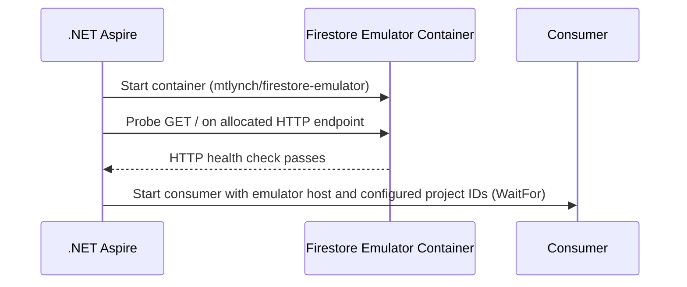

# MVFC.Aspire.Helpers.GcpFirestore

> 🇺🇸 [Read in English](README.md)

[](https://github.com/Marcus-V-Freitas/MVFC.Aspire.Helpers/actions/workflows/ci.yml)
[](https://codecov.io/gh/Marcus-V-Freitas/MVFC.Aspire.Helpers)
[](../../LICENSE)


Helpers para integração com Google Cloud Firestore em projetos .NET Aspire, incluindo suporte ao emulador.

## Motivação

Os IDs de projeto Firestore são avaliados ao montar o ambiente do projeto consumidor, permitindo adicionar configurações antes ou depois de `WithReference`.

Trabalhar com Google Cloud Firestore localmente normalmente significa:

- Subir um container de emulador na mão.
- Lembrar portas, project IDs e variáveis de ambiente.
- Configurar manualmente verificações de readiness para o emulador.

Com o .NET Aspire você pode definir containers, mas ainda precisa:

- Configurar a imagem do emulador e suas portas.
- Manter variáveis de ambiente do emulador em sincronia entre projetos.
- Definir configurações de projeto de forma consistente antes da aplicação rodar.

O `MVFC.Aspire.Helpers.GcpFirestore` fornece:

- `AddGcpFirestore(...)` para iniciar o emulador.
- `WithFirestoreConfigs(...)` para descrever configurações de projeto via código.
- `WithReference(...)` para ligar projetos ao emulador e injetar configurações de conexão automaticamente.

## Visão Geral

Este projeto facilita a configuração e integração do Google Cloud Firestore em aplicações distribuídas .NET Aspire, fornecendo métodos de extensão para:

- Adicionar o emulador do Google Cloud Firestore.
- Configurar project IDs automaticamente na inicialização.
- Injetar adequadamente a connection string do host do emulador para detecção automática pelos clientes do Firestore.

## Vantagens do Emulador Firestore

- Simula bancos de dados Firestore localmente para desenvolvimento e testes.
- Permite testar operações de dados sem depender da infraestrutura do Google Cloud.
- Facilita o desenvolvimento de implementações robustas de armazenamento de dados.

## Imagens compatíveis

- **Emulator**:
  - `mtlynch/firestore-emulator` (Padrão no helper do Aspire)

## Estrutura do Projeto

- [`MVFC.Aspire.Helpers.GcpFirestore`](MVFC.Aspire.Helpers.GcpFirestore.csproj): Biblioteca de helpers e extensões para Firestore.

## Funcionalidades

- Adiciona o emulador do Google Cloud Firestore.
- Configura project IDs conforme configuração.
- Um health check HTTP consulta a raiz do emulador. Use `WaitFor(firestore)` para aguardar essa verificação; ela não valida autenticação nem operações de dados.
- Métodos de extensão para facilitar a configuração no AppHost.

## Instalação

```sh
dotnet add package MVFC.Aspire.Helpers.GcpFirestore
dotnet add package Aspire.Hosting.Dotnet --version 17.0.0
```

Os comandos e exemplos com `AddDotnetProject` usam um AppHost .NET 10/11 com Aspire 17. Em AppHosts .NET 9, mantenha Aspire 13.6.5, omita `Aspire.Hosting.Dotnet` 17 e use `AddProject<Projects.MyApi>("api")`. Ajuste o caminho do projeto ao seu AppHost.

## Uso rápido no Aspire (AppHost)

```csharp
using Aspire.Hosting;
using MVFC.Aspire.Helpers.GcpFirestore;
using MVFC.Aspire.Helpers.GcpFirestore.Models;

var builder = DistributedApplication.CreateBuilder(args);

var firestoreConfig = new FirestoreConfig(
    projectId: "test-project");

var firestore = builder.AddGcpFirestore("gcp-firestore")
                       .WithFirestoreConfigs(firestoreConfig);

builder.AddDotnetProject("api-exemplo", "../MVFC.Aspire.Helpers.Playground.Api/MVFC.Aspire.Helpers.Playground.Api.csproj")
       .WithReference(firestore)
       .WaitFor(firestore);

await builder.Build().RunAsync();
```

## Configuração de Recursos Emulados

### `FirestoreConfig`

| Parâmetro   | Tipo   | Padrão | Descrição                               |
| ----------- | ------ | ------ | --------------------------------------- |
| `projectId` | string | —      | ID do projeto GCP usado pelo Firestore. |

## Portas

- **Porta HTTP:** `8084` *(mapeada para a porta interna `8080` do container)*

## Diagrama de provisionamento



## Métodos Públicos

- `AddGcpFirestore` – adiciona o container do emulador.
- `WithFirestoreConfigs` – configura project IDs.
- `WithDockerImage` – substitui a imagem Docker usada pelo recurso.
- `WithReference` – liga projetos ao emulador e configura a variável de ambiente `FIRESTORE_EMULATOR_HOST` automaticamente.

## Imagem padrão

A imagem padrão é fixada por digest SHA256 testado. Para selecionar outra imagem/tag, use `WithDockerImage(image, tag)` ou os métodos de imagem do Aspire; a sobrescrita remove o digest anterior. Consulte os [contratos de execução](../../docs/runtime-contracts.pt-BR.md) para política de atualização, prontidão e limites dos emuladores.

## Requisitos

- .NET 9, 10 ou 11
- Aspire.Hosting 13.6.5 no .NET 9; Aspire.Hosting 17.0.0 no .NET 10/11. Exemplos de AppHost usam `Aspire.Hosting.Dotnet` 17 e `AddDotnetProject`; AppHosts .NET 9 mantêm o modelo `ProjectResource`.
- Docker em execução
- Google.Cloud.Firestore >= 4.7.0

## Licença

Apache-2.0
