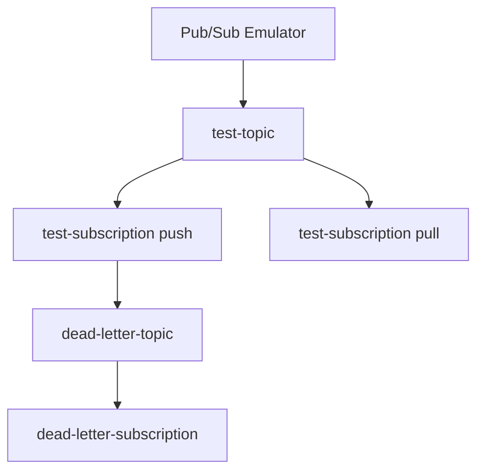
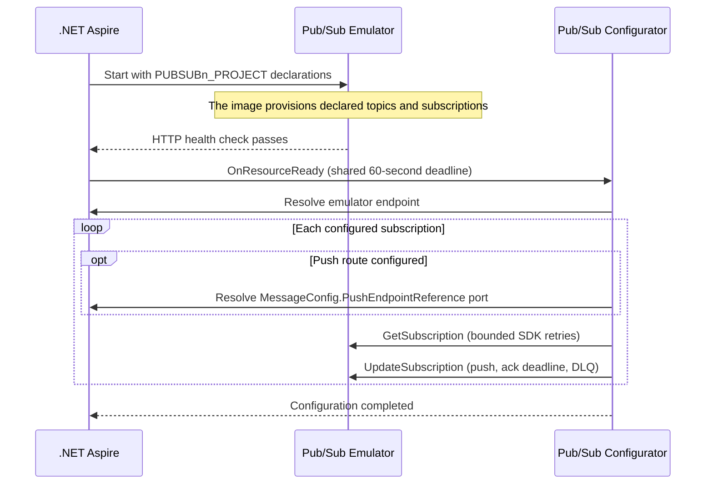

# MVFC.Aspire.Helpers.GcpPubSub

> 🇧🇷 [Leia em Português](README.pt-BR.md)

[](https://github.com/Marcus-V-Freitas/MVFC.Aspire.Helpers/actions/workflows/ci.yml)
[](https://codecov.io/gh/Marcus-V-Freitas/MVFC.Aspire.Helpers)
[](../../LICENSE)


Helpers for integrating with Google Pub/Sub in .NET Aspire projects, including support for the emulator and administration interface (UI).

## Motivation

Use `.WithConfigurationTimeout(120)` to override the default 60-second configuration deadline per emulator. Positive whole seconds up to 4,294,967 are supported. This deadline is shared across endpoint resolution and all subscription configuration; it is not restarted for each subscription. `.WithWaitTimeout(...)` controls the image separately. The UI is an optional administrative dependency; consumers should wait for the emulator itself.

Subscription configuration has a shared deadline of 60 seconds by default, including emulator and consumer endpoint resolution, client creation and SDK retries. Reads retry transient SDK errors and `NotFound` while the emulator image creates the declared subscriptions, with exponential backoff, jitter and at most 30 attempts. Subscription updates retain the SDK retry policy. AppHost cancellation interrupts calls and retry waits; expiration of the shared deadline raises `TimeoutException`. Configuration start, completion and final failures are logged against the emulator resource in the Aspire dashboard. `WithWaitTimeout` continues to control only the image's initialization timeout.

Project configurations may be added before or after references. Provisioning reads the current configuration when the emulator is ready. Each push subscription must select its consumer through `MessageConfig.PushEndpointReference`. There is no implicit destination derived from `WithReference(pubSub)`.

Push subscriptions combine the `PushEndpoint` route with the allocated port of `PushEndpointReference`, reached from the container through the Docker host. The port is resolved per subscription under the shared deadline. An explicit destination is required whenever a push route is configured; a missing destination raises `InvalidOperationException`. Reusing a topic across consumers requires a separate subscription for each destination. In the playground, `GET /api/pub-sub-enter` publishes a message and `POST /api/pub-sub-exit` receives the push. The publication response in Scalar does not include the response from this asynchronous callback.

Working with Google Pub/Sub locally usually means:

- Spinning up an emulator container by hand.
- Remembering ports, project IDs and environment variables.
- Manually creating topics/subscriptions and DLQs.

With .NET Aspire you can define containers, but you still need to:

- Configure the emulator image and its ports.
- Keep emulator environment variables in sync across projects.
- Define topics/subscriptions/DLQs in a consistent way.

`MVFC.Aspire.Helpers.GcpPubSub` provides:

- `AddGcpPubSub(...)` to start the emulator.
- `WithPubSubConfigs(...)` to describe topics/subscriptions in code.
- `AddGcpPubSubUI(...)` to add a simple web UI.
- `WithReference(...)` to wire projects to the emulator and/or UI.

## Overview

This project facilitates the configuration and integration of Google Pub/Sub in distributed .NET Aspire applications, providing extension methods to:

- Add the Google Pub/Sub emulator.
- Configure topics and subscriptions automatically.
- Support push and pull subscriptions.
- Provide an administration interface (UI) for management.

## Pub/Sub emulator advantages

- Simulates message flow between services locally.
- Supports testing push and pull subscriptions without depending on Google Cloud infrastructure.
- Facilitates development and debugging of asynchronous integrations.

### Push delivery to multiple consumers

```csharp
var first = builder.AddProject<Projects.FirstApi>("first");
var second = builder.AddProject<Projects.SecondApi>("second");

var pubSub = builder.AddGcpPubSub("pubsub")
    .WithPubSubConfigs(new PubSubConfig("project", messageConfigs:
    [
        new MessageConfig("events", "first-subscription", "/events")
        {
            PushEndpointReference = first.GetEndpoint("http"),
        },
        new MessageConfig("events", "second-subscription", "/notifications")
        {
            PushEndpointReference = second.GetEndpoint("http"),
        },
    ]));

first.WithReference(pubSub);
second.WithReference(pubSub);
```

Explicit destinations are independent of reference order. Configurations without a push route remain pull subscriptions, even when an endpoint reference is supplied.

## Compatible Images

- **Emulator**:
  - `thekevjames/gcloud-pubsub-emulator`
  - `messagebird/gcloud-pubsub-emulator`
- **UI**:
  - `echocode/gcp-pubsub-emulator-ui`

## Project Structure

- [`MVFC.Aspire.Helpers.GcpPubSub`](MVFC.Aspire.Helpers.GcpPubSub.csproj): Helpers and extensions library for Pub/Sub.

## Features

- Adds the Google Pub/Sub emulator.
- Creates topics and subscriptions according to configuration.
- Supports push and pull subscriptions.
- Provides a Pub/Sub administration interface (UI).
- Extension methods to facilitate AppHost configuration.
- Dead Letter (DLQ) support.

## Installation

```sh
dotnet add package MVFC.Aspire.Helpers.GcpPubSub
```

## Quick Aspire usage (AppHost)

```csharp
using Aspire.Hosting;
using MVFC.Aspire.Helpers.GcpPubSub;
using MVFC.Aspire.Helpers.GcpPubSub.Models;

var builder = DistributedApplication.CreateBuilder(args);
var api = builder.AddProject<Projects.MVFC_Aspire_Helpers_Playground_Api>("api");

var messageConfig = new MessageConfig(
    TopicName: "test-topic",
    SubscriptionName: "test-subscription",
    PushEndpoint: "/api/pub-sub-exit")
{
    PushEndpointReference = api.GetEndpoint("http"),
    DeadLetterTopic = "test-dead-letter-topic",
    MaxDeliveryAttempts = 5,
    AckDeadlineSeconds = 300,
};

var pubSubConfig = new PubSubConfig(
    projectId: "test-project",
    messageConfig: messageConfig);

var gcpPubSub = builder.AddGcpPubSub("gcp-pubsub")
    .WithPubSubConfigs([pubSubConfig])
    .WithWaitTimeout(seconds: 5)
    .WithConfigurationTimeout(seconds: 120);

var ui = builder.AddGcpPubSubUI("pubsub-ui")
    .WithReference(gcpPubSub)
    .WaitFor(gcpPubSub);

api.WithReference(gcpPubSub)
       .WaitFor(gcpPubSub);

await builder.Build().RunAsync();
```

## Topics and subscriptions configuration

### `PubSubConfig`

| Parameter       | Type            | Default | Description               |
| --------------- | --------------- | ------- | ------------------------- |
| `projectId`     | string          | —       | GCP project ID.           |
| `messageConfig` | `MessageConfig` | —       | Message configuration.    |
| `secondsDelay`  | int             | `5`     | Legacy value stored in `UpDelay`; currently has no effect on initialization. |

`secondsDelay` and `UpDelay` do not control retries or timeouts. Use `WithWaitTimeout(seconds)` for the emulator image timeout and `WithConfigurationTimeout(seconds)` for the shared subscription configuration deadline (60 seconds by default).

### `MessageConfig`

| Parameter             | Type    | Default | Description                         |
| --------------------- | ------- | ------- | ----------------------------------- |
| `TopicName`           | string  | —       | Topic name.                         |
| `SubscriptionName`    | string? | `null`  | Subscription name.                  |
| `PushEndpoint`        | string? | `null`  | HTTP route for push delivery.       |
| `PushEndpointReference` | EndpointReference? | `null` | Consumer endpoint; required when a push route is configured. |
| `DeadLetterTopic`     | string? | `null`  | Dead letter topic name (DLQ).       |
| `MaxDeliveryAttempts` | int?    | `null`  | Max attempts before sending to DLQ. |
| `AckDeadlineSeconds`  | int?    | `null`  | Ack deadline (seconds).             |

**Note:** If `DeadLetterTopic` is provided, the subscription `{DeadLetterTopic}-subscription` will be created automatically.

## Ports

- **Emulator port:** `8681`
- **UI port:** `8680`

## Topics and subscriptions diagram



## Provisioning diagram



## Public methods

- `AddGcpPubSub` – adds the emulator.  
- `AddGcpPubSubUI` – adds the Pub/Sub UI.  
- `WithPubSubConfigs` – configures projects, topics and subscriptions.  
- `WithWaitTimeout` – sets the emulator image initialization timeout in seconds; it does not change the subscription configuration deadline.
- `WithConfigurationTimeout` – sets the shared endpoint resolution and subscription configuration deadline per emulator, in seconds (default: 60); it does not change image initialization.
- `WithReference` – wires projects to emulator/UI and sets env vars.

## Requirements

- .NET 9, 10 or 11
- Aspire.Hosting >= 13.6.5
- Docker running locally
- Google.Cloud.PubSub.V1 >= 3.39.0

## License

Apache-2.0
