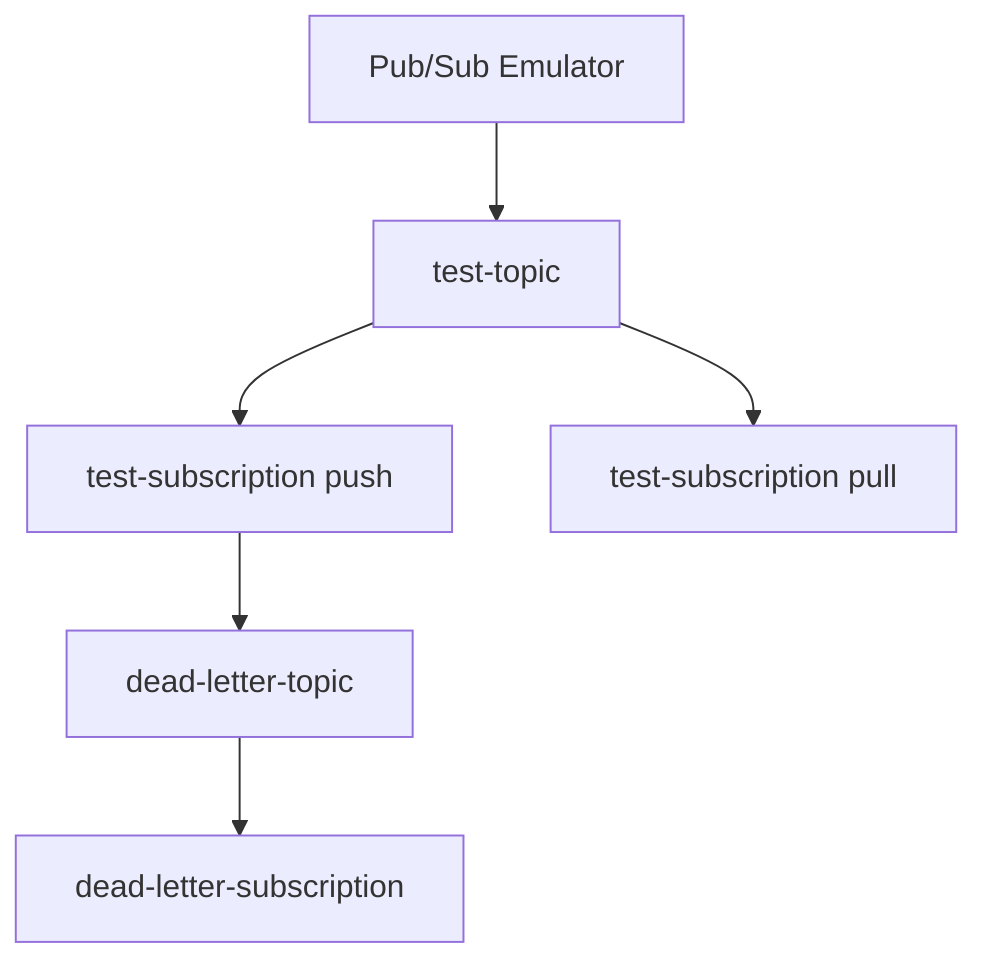
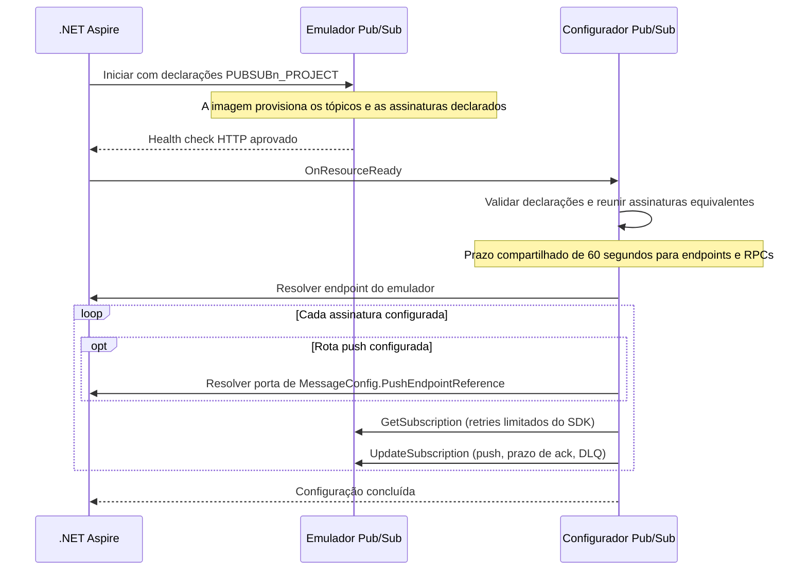

# MVFC.Aspire.Helpers.GcpPubSub

> 🇺🇸 [Read in English](README.md)

[](https://github.com/Marcus-V-Freitas/MVFC.Aspire.Helpers/actions/workflows/ci.yml)
[](https://codecov.io/gh/Marcus-V-Freitas/MVFC.Aspire.Helpers)
[](../../LICENSE)


Helpers para integração com Google Pub/Sub em projetos .NET Aspire, incluindo suporte ao emulador e interface de administração (UI).

## Motivação

Use `.WithConfigurationTimeout(120)` para alterar o prazo padrão de configuração de 60 segundos por emulador. São aceitos segundos inteiros positivos até 4.294.967. O prazo é compartilhado entre resolução dos endpoints e toda a configuração das subscriptions; não é reiniciado por subscription. `.WithWaitTimeout(...)` controla a imagem separadamente. A UI é uma dependência administrativa opcional; consumidores devem aguardar o próprio emulador.

A configuração das subscriptions tem um prazo total padrão de 60 segundos, incluindo a resolução dos endpoints do emulador e do consumidor, a criação do cliente e os retries do SDK. As consultas repetem erros transitórios do SDK e `NotFound` enquanto a imagem cria as subscriptions declaradas, com backoff exponencial, jitter e até 30 tentativas. As atualizações mantêm a política de retry do SDK. O cancelamento do AppHost interrompe chamadas e esperas; o esgotamento do prazo total gera `TimeoutException`. Início, conclusão e falhas finais são registrados no recurso do emulador no dashboard Aspire. `WithWaitTimeout` continua controlando somente o timeout de inicialização da imagem.

As configurações podem ser adicionadas antes ou depois das referências. O provisionamento lê a configuração vigente quando o emulador fica pronto. Cada assinatura push deve selecionar seu consumidor por `MessageConfig.PushEndpointReference`. Não há destino implícito derivado de `WithReference(pubSub)`.

Antes de resolver endpoints ou executar RPCs de assinaturas, o helper valida todos os identificadores de projeto/tópico, requisitos de push e limites das políticas. `AckDeadlineSeconds` aceita 10–600 segundos; null mantém o padrão da biblioteca de 300, enquanto zero explícito solicita o padrão do serviço de 10. Com DLQ configurada, `MaxDeliveryAttempts` aceita 5–100; null e zero usam 5. Declarações apenas de tópico não aplicam políticas de assinatura. Declarações para o mesmo projeto e assinatura devem ter tópico, políticas e destino push equivalentes; conflitos geram `InvalidOperationException`, enquanto declarações equivalentes produzem uma única atualização. Consumidores diferentes precisam de nomes de assinatura diferentes. Essa validação evita atualizações parciais por erros estáticos de configuração; falhas de RPC em execução ainda podem deixar algumas assinaturas configuradas.

Para assinaturas push, a rota de `PushEndpoint` é combinada com a porta alocada de `PushEndpointReference`, acessível pelo container via host Docker. A porta é resolvida por assinatura dentro do prazo compartilhado. O destino explícito é obrigatório quando houver uma rota push; a ausência dele gera `InvalidOperationException`. Para entregar as mensagens de um tópico a vários consumidores, use uma assinatura diferente por destino. No playground, `GET /api/pub-sub-enter` publica a mensagem e `POST /api/pub-sub-exit` recebe o push. A resposta de publicação no Scalar não contém a resposta desse callback assíncrono.

Trabalhar com Google Pub/Sub localmente normalmente significa:

- Subir um container de emulador na mão.
- Lembrar portas, project IDs e variáveis de ambiente.
- Criar manualmente tópicos, assinaturas e DLQs.

Com o .NET Aspire você pode definir containers, mas ainda precisa:

- Configurar a imagem do emulador e suas portas.
- Manter variáveis de ambiente do emulador em sincronia entre projetos.
- Definir tópicos/assinaturas/DLQs de forma consistente.

O `MVFC.Aspire.Helpers.GcpPubSub` fornece:

- `AddGcpPubSub(...)` para iniciar o emulador.
- `WithPubSubConfigs(...)` para descrever tópicos/assinaturas em código.
- `AddGcpPubSubUI(...)` para adicionar uma UI web simples.
- `WithReference(...)` para ligar projetos ao emulador e/ou UI.

## Visão Geral

Este projeto facilita a configuração e integração do Google Pub/Sub em aplicações distribuídas .NET Aspire, fornecendo métodos de extensão para:

- Adicionar o emulador do Google Pub/Sub.
- Configurar tópicos e assinaturas automaticamente.
- Suporte a assinaturas do tipo push e pull.
- Disponibilizar interface de administração (UI) para gerenciamento.

### Vantagens do Emulador Pub/Sub

- Permite simular o fluxo de mensagens entre serviços localmente.
- Suporte a testes de assinaturas push e pull sem depender da infraestrutura do Google Cloud.
- Facilita o desenvolvimento e depuração de integrações assíncronas.

### Entrega push para múltiplos consumidores

```csharp
var first = builder.AddProject<Projects.FirstApi>("first");
var second = builder.AddProject<Projects.SecondApi>("second");

var pubSub = builder.AddGcpPubSub("pubsub")
    .WithPubSubConfigs(new PubSubConfig("project", messageConfigs:
    [
        new MessageConfig("events", "first-subscription", "/events")
        {
            PushEndpointReference = first.GetEndpoint("http"),
        },
        new MessageConfig("events", "second-subscription", "/notifications")
        {
            PushEndpointReference = second.GetEndpoint("http"),
        },
    ]));

first.WithReference(pubSub);
second.WithReference(pubSub);
```

Destinos explícitos independem da ordem das referências. Configurações sem rota push continuam sendo assinaturas pull, mesmo quando uma referência de endpoint é informada.

## Imagens compatíveis

- **Emulator**:
  - `thekevjames/gcloud-pubsub-emulator`
  - `messagebird/gcloud-pubsub-emulator`
- **UI**:
  - `echocode/gcp-pubsub-emulator-ui`

## Estrutura do Projeto

- [`MVFC.Aspire.Helpers.GcpPubSub`](MVFC.Aspire.Helpers.GcpPubSub.csproj): Biblioteca de helpers e extensões para Pub/Sub.

## Funcionalidades

- Adiciona o emulador do Google Pub/Sub.
- Cria tópicos e assinaturas conforme configuração.
- Suporte a assinaturas push e pull.
- Disponibiliza interface de administração (UI) para Pub/Sub.
- Métodos de extensão para facilitar a configuração no AppHost.
- Suporte a Dead Letter (DLQ).

## Instalação

```sh
dotnet add package MVFC.Aspire.Helpers.GcpPubSub
```

## Uso rápido no Aspire (AppHost)

```csharp
using Aspire.Hosting;
using MVFC.Aspire.Helpers.GcpPubSub;
using MVFC.Aspire.Helpers.GcpPubSub.Models;

var builder = DistributedApplication.CreateBuilder(args);
var api = builder.AddProject<Projects.MVFC_Aspire_Helpers_Playground_Api>("api");

var messageConfig = new MessageConfig(
    TopicName: "test-topic",
    SubscriptionName: "test-subscription",
    PushEndpoint: "/api/pub-sub-exit")
{
    PushEndpointReference = api.GetEndpoint("http"),
    DeadLetterTopic = "test-dead-letter-topic",
    MaxDeliveryAttempts = 5,
    AckDeadlineSeconds = 300,
};

var pubSubConfig = new PubSubConfig(
    projectId: "test-project",
    messageConfig: messageConfig);

var gcpPubSub = builder.AddGcpPubSub("gcp-pubsub")
    .WithPubSubConfigs([pubSubConfig])
    .WithWaitTimeout(seconds: 5)
    .WithConfigurationTimeout(seconds: 120);

var ui = builder.AddGcpPubSubUI("pubsub-ui")
    .WithReference(gcpPubSub)
    .WaitFor(gcpPubSub);

api.WithReference(gcpPubSub)
       .WaitFor(gcpPubSub);

await builder.Build().RunAsync();
```

## Configuração de Tópicos e Assinaturas

### `PubSubConfig`

| Parâmetro       | Tipo            | Padrão | Descrição                                       |
| --------------- | --------------- | ------ | ----------------------------------------------- |
| `projectId`     | string          | —      | ID do projeto GCP.                              |
| `messageConfig` | `MessageConfig` | —      | Configuração de mensagem (tópico + assinatura). |
| `secondsDelay`  | int             | `5`    | Valor legado armazenado em `UpDelay`; atualmente não afeta a inicialização.           |

`secondsDelay` e `UpDelay` não controlam retries nem timeouts. Use `WithWaitTimeout(seconds)` para o timeout da imagem do emulador e `WithConfigurationTimeout(seconds)` para o prazo compartilhado de configuração das assinaturas (60 segundos por padrão).

### `MessageConfig`

| Parâmetro             | Tipo    | Padrão | Descrição                                   |
| --------------------- | ------- | ------ | ------------------------------------------- |
| `TopicName`           | string  | —      | Nome do tópico.                             |
| `SubscriptionName`    | string? | `null` | Nome da assinatura.                         |
| `PushEndpoint`        | string? | `null` | Rota HTTP para entrega via push. |
| `PushEndpointReference` | EndpointReference? | `null` | Endpoint do consumidor; obrigatório quando houver uma rota push. |
| `DeadLetterTopic`     | string? | `null` | Nome do tópico de dead letter (DLQ).        |
| `MaxDeliveryAttempts` | int?    | `null` | Máximo de tentativas antes de enviar à DLQ. |
| `AckDeadlineSeconds`  | int?    | `null` | Tempo em segundos para confirmação (ack).   |

**Observação:** Se `DeadLetterTopic` for informado, a subscription `{DeadLetterTopic}-subscription` será criada automaticamente.

## Portas

- **Porta do Emulador:** `8681`
- **Porta da UI:** `8680`

## Estrutura de Tópicos e Assinaturas



## Diagrama de provisionamento



## Métodos Públicos

- `AddGcpPubSub` – adiciona o emulador.
- `AddGcpPubSubUI` – adiciona a UI do Pub/Sub.
- `WithPubSubConfigs` – configura projetos, tópicos e assinaturas.
- `WithWaitTimeout` – define o timeout de inicialização da imagem do emulador em segundos; não altera o prazo da configuração das assinaturas.
- `WithConfigurationTimeout` – define o prazo compartilhado de resolução dos endpoints e configuração das assinaturas por emulador, em segundos (padrão: 60); não altera a inicialização da imagem.
- `WithReference` – liga projetos ao emulador/UI e configura variáveis de ambiente.

## Requisitos

- .NET 9, 10 or 11
- Aspire.Hosting >= 13.6.5
- Docker em execução
- Google.Cloud.PubSub.V1 >= 3.39.0

## Licença

Apache-2.0
