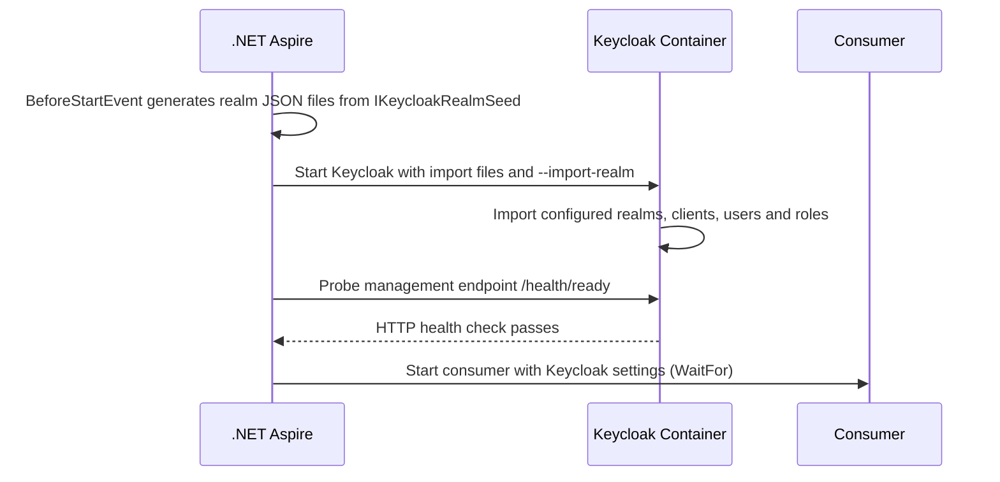

# MVFC.Aspire.Helpers.Keycloak

> 🇺🇸 [Read in English](README.md)

[](https://github.com/Marcus-V-Freitas/MVFC.Aspire.Helpers/actions/workflows/ci.yml)
[](https://codecov.io/gh/Marcus-V-Freitas/MVFC.Aspire.Helpers)
[](../../LICENSE)


Este pacote fornece métodos de extensão para o **.NET Aspire**, facilitando a integração, configuração e inicialização de um servidor **Keycloak** para gerenciar identidade e acesso no ambiente local.

Com ele, você pode não apenas inicializar um container Keycloak, como também injetar configurações (como `BaseUrl`, `Realm`, `ClientId`, etc.) e importar realms customizados (via seeds JSON) em tempo de desenvolvimento.

## Motivação

Chamadas repetidas de `WithSeeds` substituem a lista de seeds configurada. Uma chamada com lista vazia limpa as seeds anteriores.

O Keycloak é poderoso, mas montar um ambiente local costuma ser doloroso:

- Comandos docker enormes com variáveis de ambiente e flags de import.
- Import manual de realms, clients e usuários a partir de arquivos JSON.
- Repetição do mesmo setup para cada projeto novo ou demo.

Com o .NET Aspire você pode definir o container Keycloak, mas ainda precisa:

- Controlar credenciais de admin, portas e volumes.
- Definir uma forma repetível de semear realms/clients/usuários.
- Garantir que as aplicações esperem o Keycloak ficar pronto.

O `MVFC.Aspire.Helpers.Keycloak` transforma isso em uma API pequena e opinativa:

- `AddKeycloak(...)` sobe o Keycloak com defaults adequados para desenvolvimento.
- `WithSeeds(...)`, `WithDataBindMount(...)` centralizam as preocupações específicas do Keycloak.
- `project.WithReference(keycloak, ...)` faz o projeto esperar pelo Keycloak e o configura com as dependências corretas.

## Recursos e Funcionalidades

- **Server Embutido:** Inicia um container Keycloak oficial (atualmente `quay.io/keycloak/keycloak:26.1`).
- **Autenticação Padrão:** Opcional configuração com um `ClientId` pré-definido e seeds para desenvolvedor.
- **Porta Personalizável:** Mapeamento de portas fixo ou dinâmico pelo Aspire.
- **Injeção Transparente:** Adiciona endpoints de autenticação aos projetos `.WithReference()`, configurando URLs, realms e ClientIds como variáveis de ambiente.
- **Volume Persistente:** Opcionalmente salva o estado e as bases de dados internas.
- **Importação Dinâmica de Realm (Seeds):** Inicia seu ambiente de desenvolvimento populando Realms, Clients, Roles e Users via configuração de código.

## Instalação

Adicione o pacote ao projeto principal do AppHost do seu .NET Aspire:

```sh
dotnet add package MVFC.Aspire.Helpers.Keycloak
dotnet add package Aspire.Hosting.Dotnet --version 17.0.0
```

Os comandos e exemplos com `AddDotnetProject` usam um AppHost .NET 10/11 com Aspire 17. Em AppHosts .NET 9, mantenha Aspire 13.6.5, omita `Aspire.Hosting.Dotnet` 17 e use `AddProject<Projects.MyApi>("api")`. Ajuste o caminho do projeto ao seu AppHost.

*(Lembre-se de configurar a dependência para outros serviços, como as APIs que usarão as variáveis provisionadas!)*

## Uso rápido no Aspire (AppHost)

```csharp
using Aspire.Hosting;
using MVFC.Aspire.Helpers.Keycloak;
using MVFC.Aspire.Helpers.Keycloak.Configs;
using MVFC.Aspire.Helpers.Keycloak.Seeds;

var builder = DistributedApplication.CreateBuilder(args);

var keycloak = builder.AddKeycloak("keycloak", httpPort: 8081)
    .WithAdminCredentials("admin", "admin")
    .WithSeeds(new MyAppRealm());

var api = builder.AddDotnetProject("api", "../Minha_Api/Minha_Api.csproj")
    .WithReference(keycloak, realmName: "my-app-realm", clientId: "my-api", clientSecret: "api-secret-1234")
    .WaitFor(keycloak);

await builder.Build().RunAsync();

internal sealed class MyAppRealm : IKeycloakRealmSeed
{
    public string RealmName => "my-app-realm";

    public IReadOnlyList<KeycloakClientConfig> Clients =>
    [
        new(ClientId: "my-api", ClientSecret: "api-secret-1234",
            DirectAccessGrantsEnabled: true, AddAudienceMapper: true),
    ];
}
```

## Usando a configuração injetada na API

Por padrão, ao usar `.WithReference(keycloak, realmName, clientId, clientSecret)`, o Aspire injeta as seguintes chaves no `IConfiguration`:

| Chave de Configuração   | Descrição                                     | Exemplo                 |
| ----------------------- | --------------------------------------------- | ----------------------- |
| `Keycloak:BaseUrl`      | URL completa de acesso ao container Keycloak. | `http://localhost:8081` |
| `Keycloak:Realm`        | Nome do Realm propagado do AppHost.           | `my-app-realm`         |
| `Keycloak:ClientId`     | ID do cliente OAuth/OpenID.                   | `my-api`             |
| `Keycloak:ClientSecret` | (Opcional) Secret vinculada ao ClientId.      | `api-secret-1234`       |

Exemplo no `Program.cs` da sua API:

```csharp
var baseUrl  = builder.Configuration["Keycloak:BaseUrl"];
var realm    = builder.Configuration["Keycloak:Realm"];
var clientId = builder.Configuration["Keycloak:ClientId"];

builder.Services.AddAuthentication(JwtBearerDefaults.AuthenticationScheme)
    .AddJwtBearer(options =>
    {
        options.RequireHttpsMetadata = false; // desenvolvimento
        options.Audience = clientId;
        options.MetadataAddress = $"{baseUrl}/realms/{realm}/.well-known/openid-configuration";
        options.TokenValidationParameters = new TokenValidationParameters
        {
            ValidIssuer = $"{baseUrl}/realms/{realm}",
            ValidateIssuer = true,
            ValidateAudience = true,
            ValidAudience = clientId
        };
    });

builder.Services.AddAuthorization();
```

## Diagrama de provisionamento



## Opções do `AddKeycloak()`

| Parâmetro | Tipo | Descrição | Padrão |
| --- | --- | --- | --- |
| `name` | string | Nome obrigatório do recurso no Aspire. | — |
| `httpPort` | int | Porta HTTP exposta para os consumidores. | `8081` |
| `managementPort` | int | Porta de gerenciamento usada pelo health check `/health/ready`. | `9000` |

## Extensões Adicionais

- `.WithAdminCredentials(username, password)` – define as credenciais administrativas (padrão local: `admin`/`admin`).
- `.WithSeeds(seeds)` – aceita implementações de `IKeycloakRealmSeed`, gera os JSONs antes da inicialização e habilita `--import-realm`.
- `.WithImportStrategy(strategy)` – seleciona a estratégia de importação dos realms.
- `.WithDataVolume(volumeName)` – persiste os dados em um volume Docker nomeado.

## Requisitos

- .NET 9, 10 ou 11
- Aspire.Hosting 13.6.5 no .NET 9; Aspire.Hosting 17.0.0 no .NET 10/11. Exemplos de AppHost usam `Aspire.Hosting.Dotnet` 17 e `AddDotnetProject`; AppHosts .NET 9 mantêm o modelo `ProjectResource`.
- Docker em execução

## Licença

Apache-2.0
