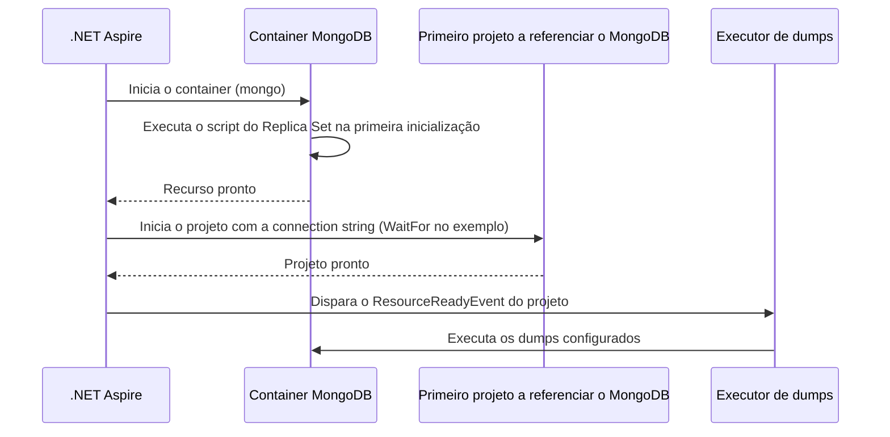

# MVFC.Aspire.Helpers.Mongo

> 🇺🇸 [Read in English](README.md)

[](https://github.com/Marcus-V-Freitas/MVFC.Aspire.Helpers/actions/workflows/ci.yml)
[](https://codecov.io/gh/Marcus-V-Freitas/MVFC.Aspire.Helpers)
[](../../LICENSE)


Helpers para integração com MongoDB em projetos .NET Aspire, incluindo suporte a Replica Set e inicialização automática.

## Motivação

Habilite a verificação de primary gravável com `builder.AddMongoReplicaSet("mongo").WithPrimaryHealthCheck()` e adicione `consumer.WaitFor(mongo)` explicitamente. Cada probe tem prazo de três segundos e reutiliza o cliente MongoDB. A verificação usa `hello.isWritablePrimary`; ela não aguarda os dumps, que mantêm o ciclo existente associado à prontidão do consumidor. Sem essa opção, o comportamento de inicialização permanece igual.

Subir o MongoDB localmente é fácil; subir um **Replica Set com comportamento realista e dados de seed** não é tão trivial.

Pontos de atrito comuns no desenvolvimento local:

- Criar e inicializar o Replica Set via scripts customizados.
- Lembrar quais portas estão expostas e como montar a connection string.
- Carregar dados de seed toda vez que o app sobe, sem ficar chamando `mongorestore` na mão.

Com o .NET Aspire você pode modelar o container do MongoDB, mas ainda precisa ligar:

- Argumentos de Replica Set e scripts de init.
- Volume de dados para persistência entre execuções.
- Configuração da connection string para os projetos.
- Qualquer lógica de seed que precisa rodar uma vez.

O `MVFC.Aspire.Helpers.Mongo` empacota essas preocupações em uma API focada:

- `AddMongoReplicaSet(...)` para ter um Replica Set pronto para uso.
- Métodos fluentes como `WithDumps(...)` e `WithDataVolume(...)`.
- `project.WithReference(mongo)` para injetar a connection string e registrar a execução automática dos dumps.

## Visão Geral

Este projeto facilita a configuração e integração do MongoDB em aplicações distribuídas .NET Aspire, fornecendo métodos de extensão para:

- Adicionar um container MongoDB configurado como Replica Set.
- Inicializar automaticamente o Replica Set via script.
- Popular o banco com dados de exemplo usando dumps customizados.

### Por que usar Replica Set?

O MongoDB só permite transações multi-documento quando configurado como Replica Set, mesmo em ambientes locais.
Ao utilizar o helper com Replica Set, você pode:

- **Simular transações locais:**  
  Testar operações de transação (commit/rollback) em múltiplos documentos e coleções, igual ao ambiente de produção.
- **Preparar para alta disponibilidade:**  
  Replica Set é a base para recursos avançados do MongoDB como failover e redundância; mesmo localmente, ajuda a rodar mais próximo de um ambiente real.

## Estrutura do Projeto

- [`MVFC.Aspire.Helpers.Mongo`](MVFC.Aspire.Helpers.Mongo.csproj): Biblioteca de helpers e extensões para MongoDB.

## Funcionalidades

- Adiciona um container MongoDB com Replica Set.
- Inicialização automática do Replica Set.
- Suporte para popular coleções com dados de exemplo.
- Métodos de extensão para facilitar a configuração no AppHost.

### Imagens compatíveis

- `mongo`

## Instalação

Adicione o pacote NuGet ao seu projeto AppHost:

```sh
dotnet add package MVFC.Aspire.Helpers.Mongo
```

## Uso rápido no Aspire (AppHost)

Exemplo mínimo usando Bogus para popular dados de teste:

```csharp
using Aspire.Hosting;
using Bogus;
using MVFC.Aspire.Helpers.Mongo;
using MVFC.Aspire.Helpers.Mongo.Models;

var builder = DistributedApplication.CreateBuilder(args);

IReadOnlyCollection<IMongoClassDump> dumps =
[
    new MongoClassDump<TestDatabase>(
        DatabaseName: "TestDatabase",
        CollectionName: "TestCollection",
        Quantity: 100,
        Faker: new Faker<TestDatabase>()
            .CustomInstantiator(f => new TestDatabase(
                f.Person.FirstName,
                f.Person.Cpf())))
];

var mongo = builder.AddMongoReplicaSet("mongo")
    .WithPrimaryHealthCheck()
    .WithDataVolume("mongo-data");

builder.AddProject<Projects.MVFC_Aspire_Helpers_Playground_Api>("api-exemplo")
       .WithReference(mongo)
       .WaitForDumps(mongo);

mongo.WithDumps(dumps);

await builder.Build().RunAsync();
```

Configure dumps, referências e `WaitForDumps` em qualquer ordem durante a configuração do AppHost. `WaitForDumps(mongo)` adiciona a prontidão do primary e aguarda a conclusão compartilhada dos dumps antes de iniciar o consumidor. Consumidores simultâneos compartilham o resultado; falha ou cancelamento da execução não gera repetição automática. Cancelar um consumidor aguardando não cancela o trabalho compartilhado iniciado pela espera; encerrar o AppHost cancela esse trabalho.

Sem `WaitForDumps`, `WithReference(mongo)` mantém o comportamento existente: os dumps são executados quando o projeto da primeira referência fica pronto. O diagrama de sequência abaixo descreve esse fluxo anterior. Use a espera explícita quando os seeds forem necessários no startup. Consulte os [contratos de execução](../../docs/runtime-contracts.pt-BR.md) para restrições de persistência e escritas parciais.

O que essa configuração entrega:

- Um Replica Set MongoDB rodando em Docker.
- Um volume Docker persistente `mongo-data` (se configurado).
- Banco/coleção populados automaticamente com dados fictícios na inicialização.
- Connection string injetada na configuração do projeto.

## Diagrama de provisionamento



## Métodos Fluentes

| Método                        | Descrição                                             |
| ----------------------------- | ----------------------------------------------------- |
| `WithDockerImage(image, tag)` | Substitui a imagem Docker utilizada.                  |
| `WithDumps(dumps)`            | Configura dumps de dados a executar na inicialização. |
| `WithPrimaryHealthCheck()` | Habilita checks de primary gravável com prazo de três segundos por probe; consumidores ainda precisam de `WaitFor(mongo)`. |
| `WithDataVolume(volumeName)`  | Habilita persistência com volume Docker.              |

## Popular dados de exemplo

O `MongoClassDump<T>` é uma classe utilizada para facilitar a inserção automática de dados de exemplo em coleções do MongoDB durante a inicialização do ambiente. Ela serve como um **template** para popular o banco com documentos fictícios, útil para testes e desenvolvimento local.

**Parâmetros principais:**

- `DatabaseName`: Nome do banco de dados.
- `CollectionName`: Nome da coleção.
- `Quantity`: Quantidade de documentos.
- `Faker`: Gerador de dados (ex: usando a biblioteca **Bogus** com a classe `Faker`).

## Parâmetros opcionais

- **`volumeName`** (opcional):  
  Nome do volume Docker local para persistir dados entre as sessões de depuração.  
  Padrão: `null` (volume descartado entre execuções).

- **`connectionStringSection`** (opcional):  
  Caminho da configuração que contém a connection string do MongoDB.  
  Padrão: `"ConnectionStrings:mongo"`.

```json
{
  "ConnectionStrings": {
    "mongo": "mongodb://localhost:27017/"
  }
}
```

## Visualização e porta

- **Porta utilizada:** `27017` (padrão do MongoDB).
- **Visualizar bancos de dados:**  
  Conecte-se via cliente MongoDB (MongoDB Compass, Robo 3T, `mongosh`) usando:

  `mongodb://localhost:27017/`

## Imagem padrão

A imagem padrão é fixada por digest SHA256 testado. Para selecionar outra imagem/tag, use `WithDockerImage(image, tag)` ou os métodos de imagem do Aspire; a sobrescrita remove o digest anterior. Consulte os [contratos de execução](../../docs/runtime-contracts.pt-BR.md) para política de atualização, prontidão e limites dos emuladores.

## Requisitos

- .NET 9, 10 or 11
- Aspire.Hosting >= 13.6.5
- Docker em execução
- Bogus >= 35.6.0
- MongoDB.Driver >= 3.11.1

## Licença

Apache-2.0

## Seeds repetíveis

`MongoClassDump<T>` continua inserindo documentos. Para substituir ou inserir pelo `_id` serializado, escolha explicitamente `MongoUpsertDump<T>` e registre-o pela mesma API `WithDumps`:

```csharp
var dump = new MongoUpsertDump<BsonDocument>(
    DatabaseName: "catalog",
    CollectionName: "items",
    Quantity: 1,
    Faker: new Faker<BsonDocument>().CustomInstantiator(_ => new BsonDocument
    {
        ["_id"] = "default-item",
        ["name"] = "Item padrão",
    }));

mongo.WithDumps(dump);
```

Forneça identidades estáveis e não nulas. IDs ausentes/nulos ou duplicados na massa são rejeitados antes da escrita. A repetição substitui o documento completo, sem remover documentos ausentes da massa. Cancelamento ou falha podem deixar escritas parciais; repita com os mesmos IDs para reconciliar. O índice único de `_id` impede identidades duplicadas; outras restrições únicas ainda podem rejeitar escritas. Em atualizações concorrentes do mesmo ID, prevalece a última escrita.

O cache compara a conexão completa com identidade ordinal sensível à capitalização, preservando diferenças em senhas e nomes de bancos.
