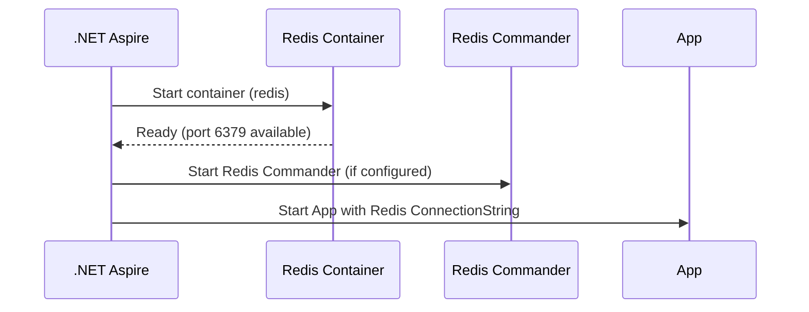

# MVFC.Aspire.Helpers.Redis

> 🇺🇸 [Read in English](README.md)

[](https://github.com/Marcus-V-Freitas/MVFC.Aspire.Helpers/actions/workflows/ci.yml)
[](https://codecov.io/gh/Marcus-V-Freitas/MVFC.Aspire.Helpers)
[](../../LICENSE)


Helper para integração com Redis em projetos .NET Aspire, incluindo cache distribuído e Redis Commander UI.

## Motivação

Habilite a verificação de conectividade TCP com `builder.AddRedis("redis").WithTcpHealthCheck()` e adicione `consumer.WaitFor(redis)` explicitamente. Cada probe tem prazo de três segundos. A verificação cobre apenas o endpoint alocado; não autentica nem executa comandos Redis. O playground também aguarda um PING autenticado dentro do prazo de inicialização do cliente. Sem essa opção, o comportamento de inicialização permanece igual e nenhuma dependência do SDK Redis é adicionada a este pacote.

Quando `WithPassword` é usado, `WithCommander` repassa a mesma senha ao Redis Commander pela variável `REDIS_PASSWORD`.

Para desenvolvimento local, o Redis é muitas vezes iniciado via container ad-hoc:

- Sem um lugar claro para centralizar a configuração de senha.
- Sem UI integrada para inspecionar chaves/valores.
- Sem uma forma consistente de montar volumes e preservar estado.

Com o .NET Aspire você pode subir o container do Redis, mas ainda precisa:

- Decidir como expor o Redis para os projetos.
- Configurar o Redis Commander (ou similar) manualmente.
- Manter as connection strings alinhadas entre os serviços.

O `MVFC.Aspire.Helpers.Redis` resolve isso com:

- `AddRedis(...)` para provisionar o Redis.
- `WithPassword(...)`, `WithCommander(...)`, `WithDataVolume(...)` para os cenários mais comuns.
- `project.WithReference(redis)` para passar a connection string via configuração.

## Visão Geral

Este projeto fornece métodos de extensão para facilitar a integração com Redis em projetos .NET Aspire, incluindo cache distribuído e Redis Commander UI.

## Estrutura do Projeto

- [`MVFC.Aspire.Helpers.Redis`](MVFC.Aspire.Helpers.Redis.csproj): Biblioteca de helpers e extensões para Redis.

## Funcionalidades

- Adiciona um container Redis configurado.
- Suporte ao Redis Commander UI.
- Suporte a persistência de dados via volume Docker (AOF habilitado).
- Suporte a senha.

### Imagens compatíveis

- `redis`
- `rediscommander/redis-commander` (UI)

## Instalação

```sh
dotnet add package MVFC.Aspire.Helpers.Redis
```

## Uso rápido no Aspire (AppHost)

```csharp
using Aspire.Hosting;
using MVFC.Aspire.Helpers.Redis;

var builder = DistributedApplication.CreateBuilder(args);

var redis = builder.AddRedis("redis")
    .WithTcpHealthCheck()
    .WithPassword("minha-senha")
    .WithCommander()
    .WithDataVolume("redis-data");

builder.AddProject<Projects.MVFC_Aspire_Helpers_Playground_Api>("api-exemplo")
       .WithReference(redis)
       .WaitFor(redis);

await builder.Build().RunAsync();
```

## Diagrama de provisionamento



## Métodos Fluentes

| Método                        | Descrição                                      |
| ----------------------------- | ---------------------------------------------- |
| `WithDockerImage(image, tag)` | Substitui a imagem Docker utilizada.           |
| `WithPassword(password)`      | Define a senha do Redis.                       |
| `WithCommander(port?)`        | Adiciona o Redis Commander UI.                 |
| `WithTcpHealthCheck()` | Habilita checks de conectividade TCP com prazo de três segundos por probe; a autenticação é validada pelo consumidor. |
| `WithDataVolume(volumeName)`  | Habilita persistência com volume Docker (AOF). |

## Principais parâmetros do `AddRedis`

- `name`: Nome do recurso Redis.
- `port` *(opcional)*: Porta do Redis (padrão: `6379`).

## Parâmetros opcionais

- **`connectionStringSection`** (opcional):  
  Caminho da configuração que contém a connection string do Redis.  
  Padrão: `"ConnectionStrings:redis"`.

```json
{
  "ConnectionStrings": {
    "redis": "localhost:6379"
  }
}
```

## Detalhes de Porta

- **Porta Redis**: definida via parâmetro `port` (padrão: `6379`).
- **Porta Redis Commander**: aleatória por padrão; pode ser definida via parâmetro `commanderPort` em `WithCommander`.

## Requisitos

- .NET 9, 10 or 11
- Aspire.Hosting >= 13.6.5
- Docker em execução

## Licença

Apache-2.0

## Autenticação do consumidor

`project.WithReference(redis)` fornece `ConnectionStrings:<nome-do-recurso>` (host/porta) e a configuração secreta `Redis:<nome-do-recurso>:Password`. As credenciais são resolvidas após a configuração fluente, inclusive com `WithPassword` depois de `WithReference`. Chamadas repetidas de `WithPassword` usam a senha final e uma única opção `--requirepass`. Conexões sem senha continuam disponíveis.

O formato de conexão do StackExchange.Redis não permite escapar vírgulas em senhas. Mantenha a senha separada e configure o cliente sem duplicar credenciais:

```csharp
var options = ConfigurationOptions.Parse(configuration.GetConnectionString("redis")!);
options.Password = configuration["Redis:redis:Password"];
var connection = await ConnectionMultiplexer.ConnectAsync(options);
```

Use o nome real do recurso nas duas configurações. Um projeto pode referenciar vários recursos Redis com senhas independentes. Consumidores em containers que usam o `WithReference` nativo do Aspire devem fornecer explicitamente a configuração de senha do seu cliente; `WithCommander` configura o Redis Commander.
